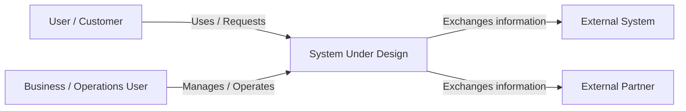

# Solution Architecture — Problem Definition

## 1. Problem Statement

<!--
Describe the problem entirely in BUSINESS language.
Do NOT mention:
- APIs
- databases
- microservices
- cloud
- programming languages
- infrastructure
- technical solutions

Focus on:
- What is happening today?
- Who is affected?
- What business problem exists?
- Why does it matter?
- What happens if nothing changes?
-->

[Write one paragraph describing the business problem.]

---

## 2. Stakeholders

| Stakeholder | Role | What They Want | Where They Disagree / Conflict |
|---|---|---|---|
| | | | |
| | | | |
| | | | |

### Stakeholder Priorities

1. **[Stakeholder]** — [Primary priority]
2. **[Stakeholder]** — [Primary priority]
3. **[Stakeholder]** — [Primary priority]

### Key Conflicts

- **[Stakeholder A] vs [Stakeholder B]:** [Describe conflict]
- **[Stakeholder A] vs Business:** [Describe conflict]

---

## 3. Success Metrics

Define measurable outcomes that determine whether the solution is successful.

| Metric | Current State | Target | Measurement Method |
|---|---:|---:|---|
| | | | |
| | | | |
| | | | |

### Business Success Criteria

- [ ] [Measurable outcome]
- [ ] [Measurable outcome]
- [ ] [Measurable outcome]
- [ ] [Measurable outcome]

---

## 4. Functional Requirements

Requirements are prioritized using **MoSCoW**.

### Must Have

Critical requirements. The solution cannot be considered successful without these.

- **FR-M01:** [Requirement]
- **FR-M02:** [Requirement]
- **FR-M03:** [Requirement]

### Should Have

Important requirements that should be included unless there is a strong reason not to.

- **FR-S01:** [Requirement]
- **FR-S02:** [Requirement]

### Could Have

Useful enhancements that provide additional value but are not essential.

- **FR-C01:** [Requirement]
- **FR-C02:** [Requirement]

### Won't Have

Explicitly excluded from the current scope.

- **FR-W01:** [Requirement]
- **FR-W02:** [Requirement]

---

## 5. Non-Functional Requirements

Every NFR must have a **measurable number**.

| ID | Category | Requirement | Target |
|---|---|---|---|
| NFR-01 | Performance | Response time | ≤ [X] ms |
| NFR-02 | Availability | System availability | ≥ [X]% |
| NFR-03 | Scalability | Concurrent users | ≥ [X] users |
| NFR-04 | Reliability | Successful transaction rate | ≥ [X]% |
| NFR-05 | Security | [Security requirement] | [Numeric target] |
| NFR-06 | Recovery | Recovery Time Objective | ≤ [X] minutes |
| NFR-07 | Recovery | Recovery Point Objective | ≤ [X] minutes |
| NFR-08 | Capacity | Transactions per second | ≥ [X] TPS |
| NFR-09 | Data | Data retention | [X] years |
| NFR-10 | Maintainability | Deployment / change target | ≤ [X] minutes |

### NFR Notes

For every NFR, answer:

- **Why is this number required?**
- **Who cares about this requirement?**
- **What happens if we don't meet it?**
- **How will we measure it?**

---

## 6. Constraints

Document limitations that the architecture must operate within.

### Business Constraints

- [Budget constraint]
- [Deadline]
- [Regulatory requirement]
- [Organizational limitation]

### Technical Constraints

- [Existing system that must remain]
- [Required platform]
- [Existing vendor]
- [Technology restriction]

### Operational Constraints

- [Team size]
- [Support model]
- [Deployment limitations]
- [Operational restrictions]

### Security / Compliance Constraints

- [Compliance requirement]
- [Data residency requirement]
- [Security policy]
- [Access restriction]

---

## 7. Assumptions

Document things believed to be true but not yet confirmed.

| ID | Assumption | Why We Are Assuming It | Impact If Wrong |
|---|---|---|---|
| A-01 | | | |
| A-02 | | | |
| A-03 | | | |
| A-04 | | | |

### Critical Assumptions

> **A critical assumption is one that could significantly change the solution if proven wrong.**

- **[Assumption]:** [Why it matters]
- **[Assumption]:** [Why it matters]

---

## 8. Open Questions and Risks

### Open Questions

Questions that must be answered before architecture decisions can be finalized.

| ID | Question | Owner | Priority | Impact |
|---|---|---|---|---|
| Q-01 | | | High | |
| Q-02 | | | Medium | |
| Q-03 | | | Low | |

### Risks

| ID | Risk | Probability | Impact | Mitigation |
|---|---|---|---|---|
| R-01 | | High/Medium/Low | High/Medium/Low | |
| R-02 | | High/Medium/Low | High/Medium/Low | |
| R-03 | | High/Medium/Low | High/Medium/Low | |

### Architecture Decision Blockers

List anything that prevents you from confidently moving to architecture design.

- [ ] [Unknown requirement]
- [ ] [Unconfirmed constraint]
- [ ] [Missing stakeholder decision]
- [ ] [Missing technical information]
- [ ] [Security/compliance decision]

---

# 9. Context Diagram

> **Important:** This is a **system context diagram**, not an architecture diagram.
>
> Do NOT include:
> - Microservices
> - Databases
> - Queues
> - APIs
> - Load balancers
> - Cloud services
> - Internal components
>
> Show only:
> - The system being designed
> - Users / actors
> - External systems
> - Important business interactions

---

# Architecture Readiness Check

Before moving from **Problem Definition → Architecture Design**, verify:

- [ ] Business problem is clearly understood
- [ ] Problem statement contains no technology solution
- [ ] All important stakeholders are identified
- [ ] Stakeholder conflicts are documented
- [ ] Business success can be measured
- [ ] Functional requirements are prioritized
- [ ] NFRs have measurable numbers
- [ ] Constraints are documented
- [ ] Assumptions are explicitly stated
- [ ] Open questions are identified
- [ ] Major risks are identified
- [ ] System boundary is clear
- [ ] External systems are identified
- [ ] Context diagram contains no internal architecture
- [ ] Architecture decisions are not being made before requirements are sufficiently understood

---

# Solution Architect Thinking Notes

## What problem am I actually solving?

[Answer]

## Why does this problem exist?

[Answer]

## What happens if we do nothing?

[Answer]

## Who benefits from solving it?

[Answer]

## What could make my solution fail?

[Answer]

## What information am I still missing?

[Answer]

## Which requirement could change my architecture the most?

[Answer]

## What assumptions am I making?

[Answer]

## What trade-offs might I eventually need to make?

[Answer]

## What would I challenge in the stakeholder's request?

[Answer]

---

# Decision Summary

### Business Problem

[One sentence]

### Desired Business Outcome

[One sentence]

### Most Important Requirement

[Requirement]

### Biggest Constraint

[Constraint]

### Biggest Risk

[Risk]

### Biggest Unknown

[Unknown]

### Architecture Decision That Must Wait

[Decision]

---

> **Rule:** Do not design the architecture until you can explain the business problem, stakeholders, requirements, constraints, assumptions, risks, and system boundary clearly enough that another architect could independently understand the problem.
